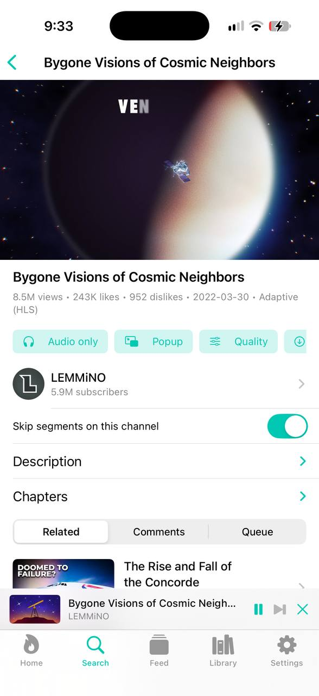
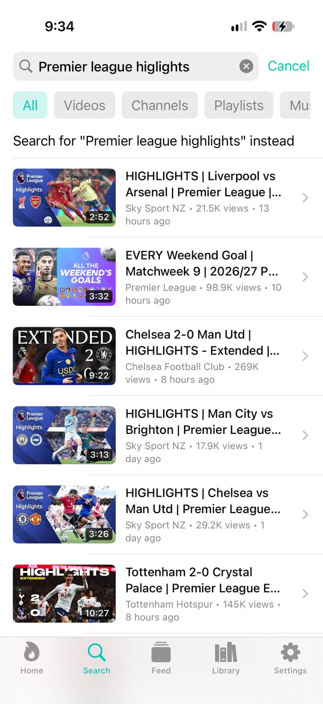
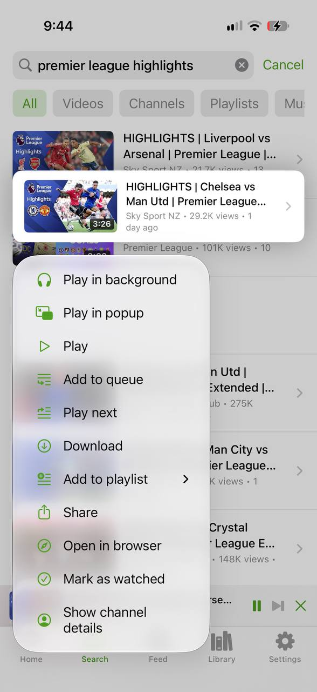
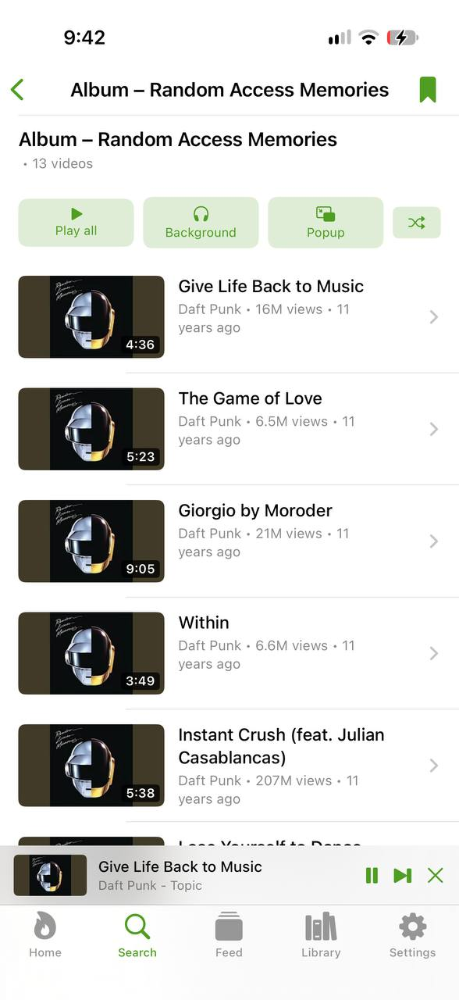
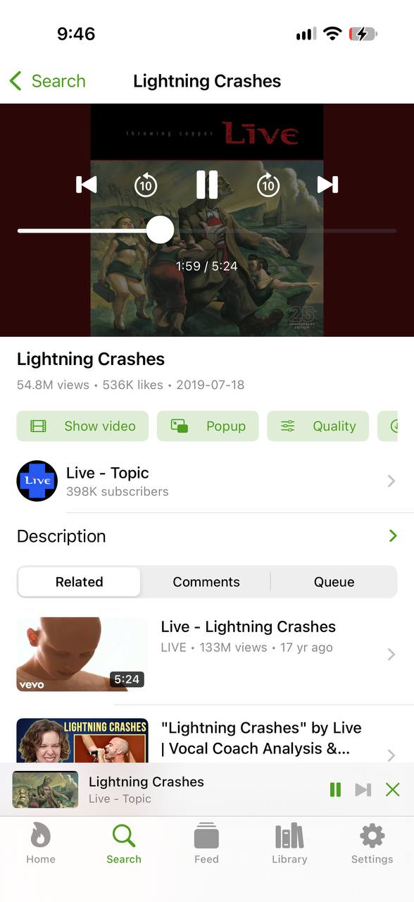
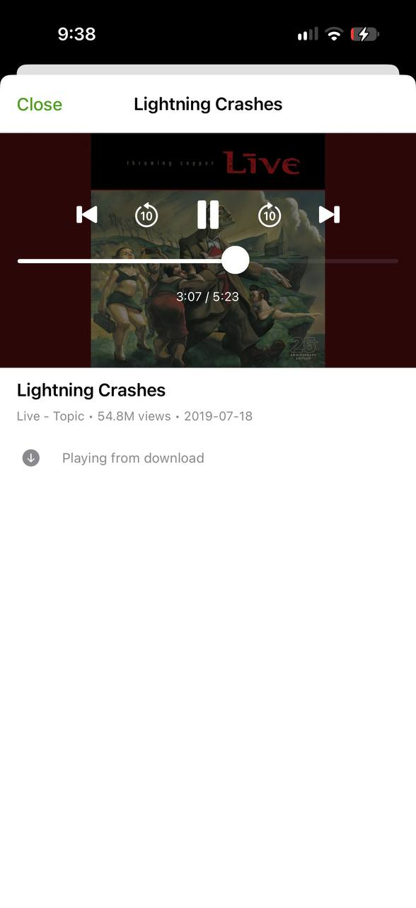
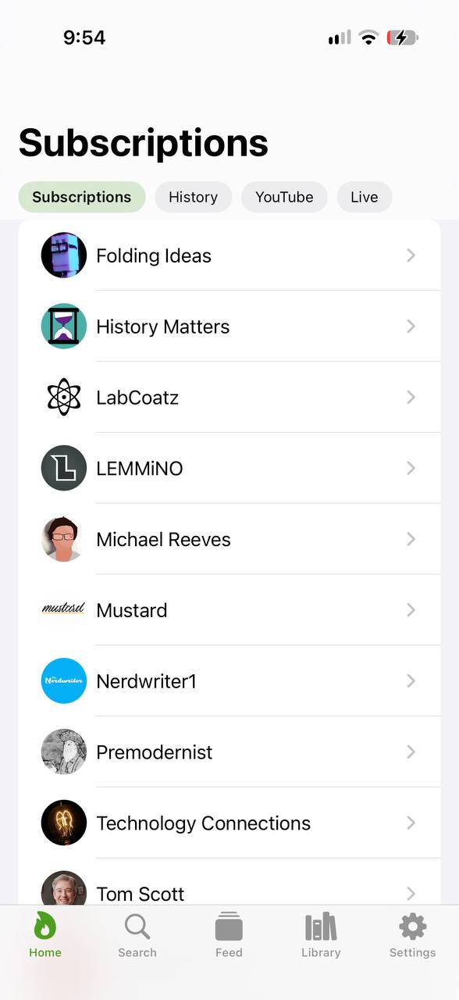
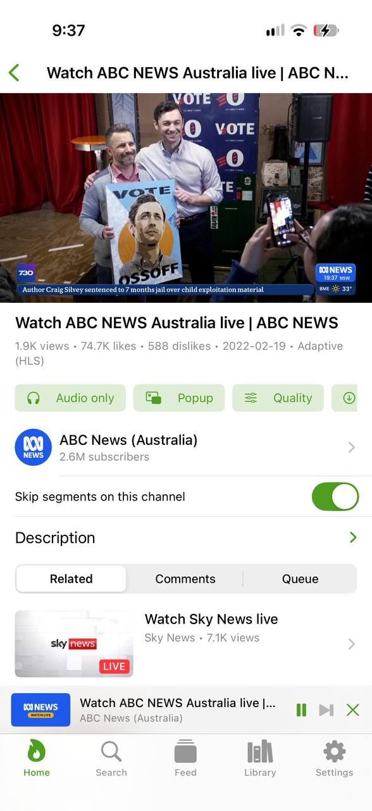
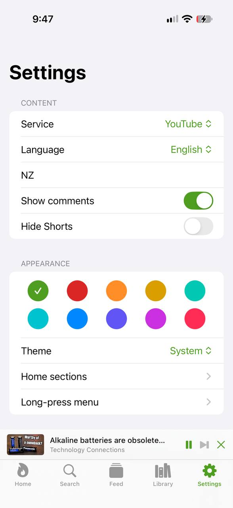

<p align="center">
  
</p>

<h1 align="center">SourPipe</h1>

<p align="center">
  NewPipe for iOS: YouTube, SoundCloud, PeerTube, Bandcamp and media.ccc.de with no account, ads or tracking.
</p>

SourPipe is a native SwiftUI port of [NewPipe](https://github.com/TeamNewPipe/NewPipe). It runs the
real [NewPipeExtractor](https://github.com/TeamNewPipe/NewPipeExtractor), compiled for iOS, so fixes
made upstream reach the app by updating one pinned commit.

It is an independent project, not made or endorsed by the NewPipe team, and not affiliated with any
of the services it supports. It uses its own name so that bug reports come here rather than to them.

## Screenshots

<table>
  <tr>
    <td></td>
    <td></td>
    <td></td>
  </tr>
  <tr>
    <td align="center">Video page, with Return YouTube Dislike counts</td>
    <td align="center">Search with filters</td>
    <td align="center">NewPipe's long-press menu</td>
  </tr>
  <tr>
    <td></td>
    <td></td>
    <td></td>
  </tr>
  <tr>
    <td align="center">Play all, in the background or a popup</td>
    <td align="center">Audio only</td>
    <td align="center">Downloads play offline</td>
  </tr>
  <tr>
    <td></td>
    <td></td>
    <td></td>
  </tr>
  <tr>
    <td align="center">Customisable Home sections</td>
    <td align="center">Live streams and SponsorBlock</td>
    <td align="center">Theme colours</td>
  </tr>
</table>

## Features

**Watching and listening**

- Browse each service's sections, search with filters and suggestions, or open a link (also
  `sourpipe://open?url=<link>`).
- Video pages with description, chapters, comments and replies, and related videos.
- NewPipe's three players: the main one, Background (audio only) and Popup, which on iOS is Picture in
  Picture. Opening the main player takes the video back from the popup.
- Play all, Background, Popup and Shuffle on playlists, albums, channels and the feed.
- Adaptive quality with a maximum, background audio, lock-screen controls, AirPlay, a queue and
  resume. Full screen is always landscape on iPhone, even with rotation lock on.

**Your library, kept on the device**

- Subscriptions with a "What's new" feed and feed groups, history, local playlists and bookmarked
  playlists.
- Downloads, which also appear in the Files app and play offline.
- Import a full backup from NewPipe, Tubular or PipePipe: subscriptions, history with resume positions
  and play counts, playlists, bookmarks, feed groups and searches. Export it on Android from
  Settings > Backup and restore, then use Settings > Import NewPipe backup here. Nothing in the library
  is deleted, importing twice changes nothing, and app preferences are not carried over. Items from
  services SourPipe lacks (PipePipe's BiliBili and NicoNico) are skipped and counted.

**Customisation**

- NewPipe's long-press menu on videos: play in background or popup, queue, download, add to playlist,
  share, open in browser, mark as watched and show channel. Reorder or hide entries in
  Settings > Long-press menu.
- Home sections, like NewPipe's "Content of main page": any mix of service sections, a single section
  of any service, What's new, subscriptions, bookmarks, history, a channel or a playlist, as tabs
  across the top.
- Ten theme colours, and light, dark or system appearance.

**From Tubular and PipePipe**

- [SponsorBlock](https://sponsor.ajay.app) on YouTube: skip, ask or ignore per category, undo,
  highlights and an exception per channel. "Ask" segments are skipped automatically in Picture in
  Picture and the background, where the button cannot be tapped.
- [Return YouTube Dislike](https://returnyoutubedislike.com) counts.

Both are off until enabled in Settings, because each contacts a third-party server: SponsorBlock gets
a hash prefix of the video ID, and Return YouTube Dislike gets the ID of every video you open.

**When a service pushes back**

- CAPTCHA solving, as in NewPipe. When a service asks for one, a bar offers to open the challenge.
  Once it is solved, the cookies it sets are kept and sent with later requests to that site only (for
  Google, only the ones NewPipe keeps, such as `GOOGLE_ABUSE_EXEMPTION`). Settings > CAPTCHA forgets
  them.

### Not included

- Subtitles. The extractor returns them, but AVPlayer cannot add external tracks to these streams.
- Sign-in of any kind, and submitting SponsorBlock segments or votes.
- The App Store. Apple does not accept apps of this kind; see below for installing.

## Install

iOS only installs signed apps, so SourPipe has to be signed with your own Apple ID. Requires iOS 16
or later.

### Without a Mac

Each commit builds an unsigned IPA. Open the newest successful run of the
[iOS workflow](https://github.com/p4t4m/sourpipe/actions/workflows/ios.yml) and download the
`SourPipe-unsigned-ipa` artifact (GitHub requires signing in, and keeps artifacts for 90 days). Then
sign and install it with a sideloading tool:

- **Windows or macOS:** [Sideloadly](https://sideloadly.io) or [AltStore](https://altstore.io).
- **Linux:** those projects have no official Linux tool. Community tools exist, or use a Windows
  machine or VM with USB access once; [SideStore](https://sidestore.io) can then refresh the app from
  the phone itself.

With a free Apple ID the app stops opening after 7 days until it is signed again; a paid developer
account extends that to a year. Developer Mode must be on (Settings > Privacy & Security). These tools
are made by third parties and ask for your Apple ID, so a separate Apple ID is a sensible choice.

### With Xcode

You need a Mac with **Xcode 16 or later**. The compiled extractor is committed, so no Java is needed.

1. Open `ios/SourPipe.xcodeproj`.
2. Select the **SourPipe** target, then **Signing & Capabilities**, and choose your **Team**. A free
   Apple ID works. If Xcode says the bundle identifier is taken, change `app.sourpipe.SourPipe` to
   one of your own.
3. Pick your device and press **Run**.

To build from the command line without signing:

```sh
cd ios
xcodebuild -project SourPipe.xcodeproj -scheme SourPipe \
  -destination 'generic/platform=iOS Simulator' CODE_SIGNING_ALLOWED=NO build
```

## How it works

```
SwiftUI views ─ PlayerController (AVPlayer) ─ DownloadManager
        │ typed async calls (Extractor), JSON
ExtractorEngine.swift ── JSContext on its own thread; provides HTTP through URLSession, and timers
        │
extractor.jsbundle ───── NewPipeExtractor + jsoup + nanojson, compiled from Java by TeaVM
```

Java cannot run directly on iOS, and a JVM with a JIT is not allowed there. [TeaVM](https://teavm.org)
compiles the extractor's bytecode ahead of time to JavaScript, which iOS's built-in JavaScriptCore
runs. Blocking network calls in the Java code become TeaVM green-thread suspensions, so the extractor
is unmodified in structure and requests can overlap.

| Path | Purpose |
| --- | --- |
| `ios/SourPipe/Core` | Models, stream selection, library data, backup import, skip logic. Tested with `swift test`; the SQLite part needs an Apple platform, the rest also runs on Linux |
| `ios/SourPipe/{App,Extractor,Player,Views}` | The Apple-only app |
| `extractor/upstream.lock` | The NewPipeExtractor commit in use |
| `extractor/patches/` | Changes to upstream source, applied on top of that commit |
| `extractor/src/bridge` | The JSON API that Swift calls (`Main.java`, `Json.java`) |
| `extractor/src/overlay` | Replacements for libraries TeaVM cannot compile: Rhino helpers, protobuf-javalite, RE2/J |
| `extractor/src/shim` | The subset of `java.time` and `ReentrantLock` that TeaVM's class library lacks |
| `extractor/test/harness.mjs` | Live tests of the bundle in an empty JavaScriptCore global, as on iOS |
| `vendor/NewPipeExtractor` | Git-ignored working checkout, created by the scripts |

## Keeping the extractor current

Services change often, and when extraction breaks the fix normally lands upstream first.

```sh
scripts/update-extractor.sh            # newest commit on upstream's dev branch
scripts/update-extractor.sh v0.26.0    # or a specific tag or commit
```

This pins the commit in `extractor/upstream.lock`, re-applies `extractor/patches/`, rebuilds
`ios/SourPipe/Resources/extractor.jsbundle` and, if [Bun](https://bun.sh) is installed, runs the live
tests with the JIT off, as on iOS. Then commit the result and rebuild the app. It needs JDK 21
(`JAVA_HOME`, `PATH`, or unpacked in `.tools/`); Gradle comes with the wrapper.

If the patch no longer applies, the script stops with an error. Files it could merge have conflict
markers in `vendor/NewPipeExtractor`; files reported as `patch does not apply` need the change redoing
by hand, using the patch file as the guide. Then run `scripts/refresh-patch.sh` followed by
`scripts/build-extractor.sh`, without re-running the sync, which would discard your edits.

To carry a fix of your own, including one upstream has not merged:

```sh
scripts/sync-extractor.sh              # clean checkout with the current patches
# edit files in vendor/NewPipeExtractor
scripts/refresh-patch.sh               # saves every edit into the one patch file
scripts/build-extractor.sh
```

Things an update may need beyond that:

- **New Java APIs.** TeaVM names anything it cannot find, such as `Method java.util.Foo.bar() was not
  found`. Add a `T`-prefixed class to `extractor/src/shim`, or patch the call.
- **New `.proto` files or fields.** The two protobuf classes in `extractor/src/overlay` are written by
  hand from `extractor/src/main/proto` upstream, and must be changed to match.
- **Changed library versions.** The script prints upstream's jsoup and nanojson changes; copy them into
  `extractor/build.gradle.kts`.

`.github/workflows/update-extractor.yml` does this weekly and opens a pull request if the repository
is on GitHub.

## Tests

```sh
cd extractor && bun test/harness.mjs ../ios/SourPipe/Resources/extractor.jsbundle   # live services
cd ios && swift test                                                                # core logic

# Also decode live bridge output with the Swift models:
bun extractor/test/dump-fixtures.mjs /tmp/fixtures
cd ios && FIXTURE_DIR=/tmp/fixtures swift test
```

`BUN_JSC_useJIT=0` runs the harness without a JIT, which is how JavaScriptCore runs inside iOS apps.

CI runs these tests, then launches the app in a simulator to play a media.ccc.de file and a PeerTube
HLS stream, enter full screen, save a download and play it back, and show the CAPTCHA screen. It
cannot play YouTube, which refuses data-center addresses with a "not a bot" error.

## Known behaviour

YouTube's DASH files are fragmented MP4s, which AVFoundation reads as twice their real length. The
player and downloads take the length from each file's segment index instead.

YouTube's `Trending` section is hidden: YouTube removed that page, so the extractor can only fail on it.

YouTube's bot check can also affect home connections and VPNs. The app reports it and does not try to
get around it. NewPipeExtractor's `PoTokenProvider` hook is not implemented here, so if YouTube starts
requiring those tokens more widely, playback may fail until that is added.

## Reporting problems

Open an issue here, not with NewPipe. When a service stops working, first check whether
NewPipeExtractor has already fixed it upstream; [Keeping the extractor current](#keeping-the-extractor-current)
explains how to bring that fix in.

## Credits

The extraction is all [NewPipeExtractor](https://github.com/TeamNewPipe/NewPipeExtractor), by the
NewPipe team and contributors. SponsorBlock and Return YouTube Dislike support follow
[Tubular](https://github.com/polymorphicshade/Tubular) and
[PipePipe](https://github.com/InfinityLoop1308/PipePipe).

## Licence

GPL v3 or later, the same as NewPipe and NewPipeExtractor; see `LICENSE`. The bundle also contains
TeaVM's class library (Apache 2.0), jsoup (MIT) and nanojson (MIT), and `EcmaScriptTokenStream` in
upstream derives from Mozilla Rhino (MPL 2.0).
